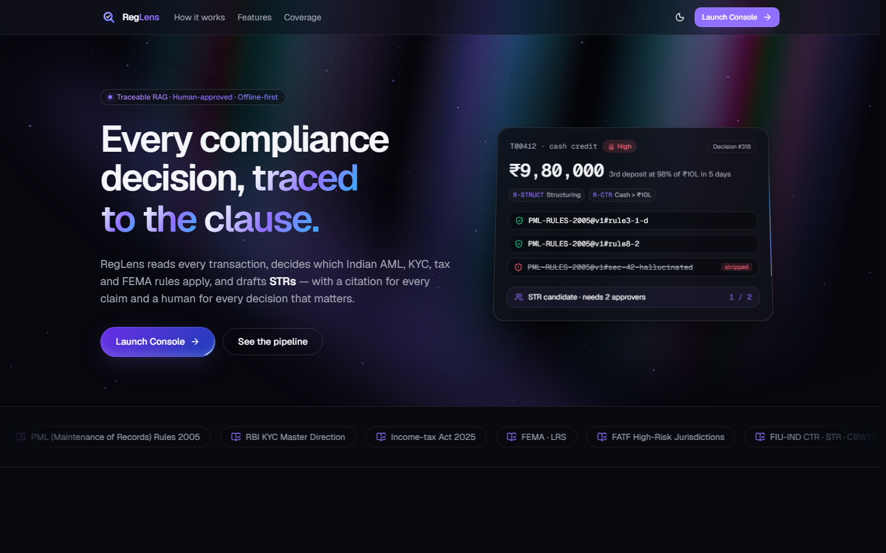

# RegLens

**Checks bank transactions against Indian compliance rules, explains which regulations apply, and sends anything important to a person for approval.**



> Educational hackathon prototype – not legal advice. Regulation texts are simplified summaries. All data is fake.

## What it does
1. **Rules flag transactions** – 10 fixed rules (big cash, structuring, foreign transfers, PEPs, risky countries, missing PAN, KYC due, …). See `RegLens-Flagging-Rules.pdf`.
2. **AI explains** – finds the matching regulation clauses and explains why they apply.
3. **Guardrail** – if the AI quotes a clause it didn't actually find, the quote is removed and the case goes to a person.
4. **People approve** – reportable or risky cases go to the review queue. Suspicious-transaction reports (STR) need two different reviewers.
5. **Draft reports** – CTR / STR / CBWTR drafts are generated from approved cases only.

## Pages
| Page | What you can do |
|---|---|
| Dashboard | Totals, risk pulse, upcoming filing deadlines |
| Transactions | Browse and filter all 600 transactions |
| Run Analysis | Re-check all transactions live, or upload your own CSV |
| Review Queue | Approve / reject cases (STR needs two people), download draft reports |
| Decision Trace | See exactly why a case was flagged: rules, clauses, AI output |

## Run it
Needs **Node.js 20+** and **Python 3.11+**.

**Windows:** double-click `start-reglens.bat` (first run installs everything, takes a few minutes).

**Any OS:**
```bash
npm run setup
npm run seed
npm run dev
```
Open **http://localhost:5173**.

Fresh demo data: `start-reglens.bat --reseed` (or `npm run seed`).

## Settings (`backend/.env`)
| Setting | Default | Meaning |
|---|---|---|
| `LLM_PROVIDER` | `mock` | `mock` works offline; `claude` uses Claude |
| `ANTHROPIC_API_KEY` | – | Needed for `claude` |
| `LLM_MODEL` | `claude-sonnet-5-5` | Claude model |

## Tech
Python · FastAPI · SQLite · ChromaDB + MiniLM embeddings · React · TypeScript · Tailwind · Motion.
Tests: `npm run test`.

## Credits
UI components rebuilt from [21st.dev](https://21st.dev) designs by **dillionverma** (Magic UI) and **manuarora700** (Aceternity) – the registry needed a login, so each was recreated with Motion + Tailwind. Each source file names its original.
