# RegLens — traceable, RAG-powered transaction compliance

> **Every compliance decision, traced to the clause.**
> RegLens reads every transaction, works out which Indian AML / KYC / tax / FEMA obligations apply,
> drafts CTRs, STRs, CBWTRs and NTRs — with a citation for every claim and a human for every decision that matters.


> ⚠️ **Disclaimer.** Educational hackathon prototype — **not legal advice**. The regulatory texts in
> `backend/data/regulations/` are paraphrased **demo summaries**, and some section numbers (especially under the
> Income-tax Act, 2025, which replaced the 1961 Act from 1 April 2026) are marked *verify*. Always check the
> official sources before relying on anything here. All customer data is synthetic.

---

## The problem
Banks must decide, for every transaction, account and reporting period, which regulations apply: cash
transaction reports above ₹10 lakh, suspicious-transaction reports within 7 working days of determination,
cross-border wire reports, PAN rules for cash, LRS limits, enhanced due diligence for PEPs and high-risk
jurisdictions, periodic KYC updates and more. Doing that by hand is slow; letting an LLM do it alone is
unauditable and prone to hallucinated thresholds and citations.

## The solution
RegLens combines **deterministic rules** (for every number), **hybrid retrieval** over a **versioned,
hash-identified knowledge base**, a **constrained LLM** (for applicability reasoning and explanation),
a **citation guardrail**, **human approval** (four-eyes for STRs) and a **tamper-evident audit chain**.

| Principle | How it is enforced |
|---|---|
| Hybrid reasoning | `rules.yaml` owns every threshold and deadline. LLM obligations are reconciled back to the rules; LLM deadlines are overwritten. |
| Traceability | Each decision stores features → rules fired (with evidence) → retrieved chunks (id, version, section, SHA-256) → model + prompt version → validated output → reviewer actions. |
| Citation guardrail | Citations not retrieved for *this* request (or belonging to another regulation) are stripped; the decision is flagged `citation_issue` and routed to a human. |
| Human-in-the-loop | Reporting obligation, risk ≥ medium, confidence < 0.6, citation issue or LLM fallback → review queue. STR needs two **different** reviewers. Nothing is reportable without approval. |
| Offline-first | Deterministic `MockLLMProvider`, local embeddings, SQLite. `LLM_PROVIDER=claude` or `ollama` switches providers. |
| Privacy | Account numbers masked (`XXXXXXXX1234`); customer IDs, names and PANs never reach the LLM. |

## Architecture

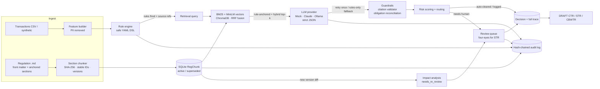

**Backend** — Python 3.11+, FastAPI, SQLAlchemy + SQLite, Pydantic v2, ChromaDB, sentence-transformers
`all-MiniLM-L6-v2`, rank-bm25 + Reciprocal Rank Fusion, pytest, ruff.
**Frontend** — Vite + React 19 + TypeScript (strict), Tailwind CSS v4, shadcn/ui conventions, Motion
(`motion/react`), TanStack Query / Table / Virtual, Zustand, React Router, Recharts, React Flow, cmdk, sonner.

```
Fintech hackathon/
  backend/
    reglens/  core/ kb/ rules/ llm/ pipeline/ review/ audit/ reports/ eval/   ← domain packages
    api/      FastAPI app (routers per domain, SSE)
    data/regulations/   *.md knowledge base (+ updates/ demo amendment)
    data/synthetic/     generated customers/accounts/transactions + ground_truth.csv
    reports/            eval.md / eval.json
    tests/              57 pytest tests
  frontend/             React app (DESIGN.md, qa/ Playwright specs)
  scripts/              setup.py, seed.py, dev.py, py.mjs (cross-platform launchers)
  docs/screenshots/     visual QA captures
```

## Quick start

Requirements: **Python 3.11+** and **Node.js 20+** (tested with Python 3.14 and Node 24 on Windows 11).

```bash
npm run setup     # venv + backend deps (+ optional ChromaDB/sentence-transformers) + npm deps
npm run seed      # synthetic data → KB → full analysis → evaluation report
npm run dev       # API on :8000 + web on :5173
```

Open **http://localhost:5173** (API docs at http://localhost:8000/docs).

**Windows shortcut:** double-click **`start-reglens.bat`**. On first run it installs dependencies and seeds
demo data; every run starts the API + web app and opens your browser. Run `start-reglens.bat --reseed` for fresh demo data.

| Command | What it does |
|---|---|
| `npm run setup -- --lite` | Skip the ML extras (uses built-in hashed embeddings + NumPy vector store) |
| `npm run test` | Backend pytest (57 tests) + frontend ESLint + TypeScript |
| `npm run build` | Production build of the frontend |
| `npm run eval` | Re-run the evaluation on current decisions |
| `npm run gen:types` | Regenerate `frontend/src/api/schema.d.ts` from the OpenAPI schema |
| `npm run qa` | Playwright visual QA (needs `npx playwright install chromium` once; the flow spec mutates data — re-seed afterwards) |

### Windows notes
* Everything runs from PowerShell — no `make` needed. The project path contains a space; all scripts quote it.
* If your Desktop is synced by **OneDrive**, pause syncing while installing: OneDrive can lock files in
  `node_modules` / `.venv` and cause `EPERM`/`EBUSY` errors.
* The first `seed` downloads the MiniLM model (~90 MB) once; afterwards it loads offline from the HF cache.

### macOS / Linux
Same three commands. `scripts/py.mjs` picks `backend/.venv/bin/python` automatically.

### Environment variables (`backend/.env`, created from `.env.example`)
| Variable | Default | Meaning |
|---|---|---|
| `LLM_PROVIDER` | `mock` | `mock` (offline, deterministic) · `claude` · `ollama` |
| `ANTHROPIC_API_KEY` | — | Required for `claude` |
| `LLM_MODEL` | `claude-sonnet-5-5` | Claude model id |
| `OLLAMA_URL` / `OLLAMA_MODEL` | `http://localhost:11434` / `llama3.1` | For `ollama` |
| `REGLENS_EMBEDDER` | `auto` | `auto` · `st` (sentence-transformers) · `hash` |
| `REGLENS_VECTOR_STORE` | `auto` | `auto` · `chroma` · `numpy` |
| `ANALYSIS_PACE_MS` | `12` | Delay per transaction in streamed batch runs (keeps the live feed watchable) |

## How traceability and human approval work
1. **Rules** (`backend/reglens/rules/rules.yaml`) are evaluated by a whitelisted DSL interpreter —
   comparisons, `near_any` threshold bands, rolling-window aggregates (`day`, `calendar_month`,
   `financial_year`, `{days: N}`) with `where`/`match` filters. No `eval`. Each hit records its evidence
   (e.g. `sum(amount_inr) over calendar_month gt 1000000 = 1130000`) and a deterministic deadline.
2. **Retrieval** always includes the fired rules' own source clauses (`source_refs`) plus hybrid
   BM25 + vector search (RRF) filtered to those regulations, plus a small unfiltered pass.
3. **LLM** returns strict JSON (Pydantic-validated). Invalid JSON → one repair retry → rules-only fallback
   flagged for review.
4. **Guardrails** strip citations that weren't retrieved and reconcile obligations to the rules.
5. **Routing** sends anything reportable, risky, low-confidence or guard-flagged to the **review queue**;
   STR candidates require two distinct approvers, and the STR clock starts on the determination date.
6. **Audit**: every analysis, review and KB change is appended to a SHA-256 hash chain
   (`hashₙ = SHA256(prev_hash ‖ timestamp ‖ event ‖ entity ‖ actor ‖ payload)`); `GET /api/audit/verify`
   recomputes it, and a tamper-detection test edits a row directly to prove the break is caught.
7. **Change impact**: uploading a new version of a regulation supersedes old chunks (kept), diffs sections
   by anchor + hash, and flags every decision that *cited* a changed clause as `needs_re_review`.

## UI feature tour
| | |
|---|---|
| 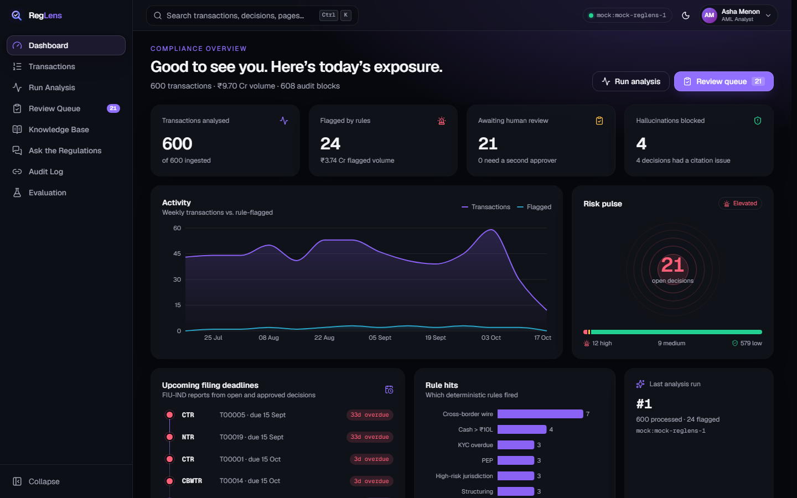 **Dashboard** — bento grid, number tickers, animated charts, live risk pulse, filing-deadline timeline with countdown chips. | 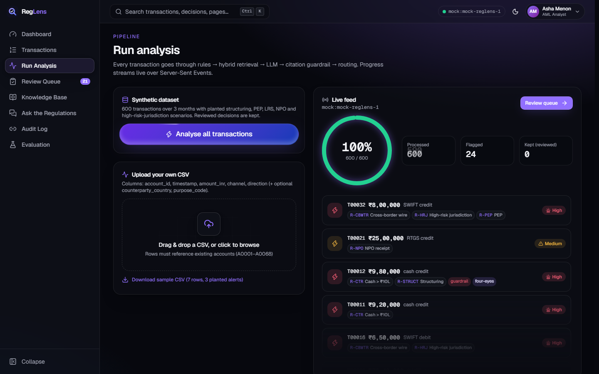 **Run analysis** — drag-and-drop CSV or synthetic data; SSE progress ring and a streaming feed of flagged transactions. |
| 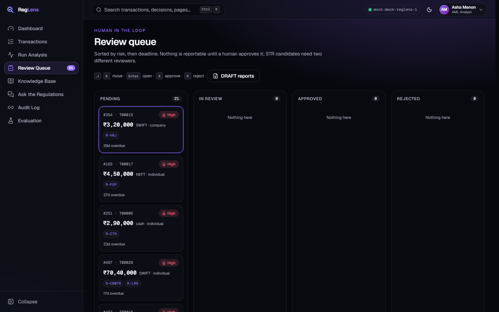 **Review queue** — kanban columns with layout animations, J/K/A/R shortcuts, shared-element detail view. | 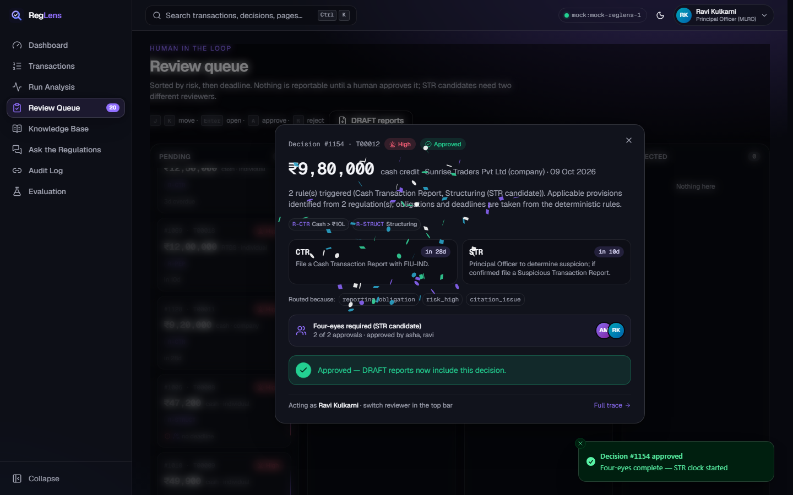 **Four-eyes STR** — hold-to-approve radial button, second-approver state, success burst. |
| 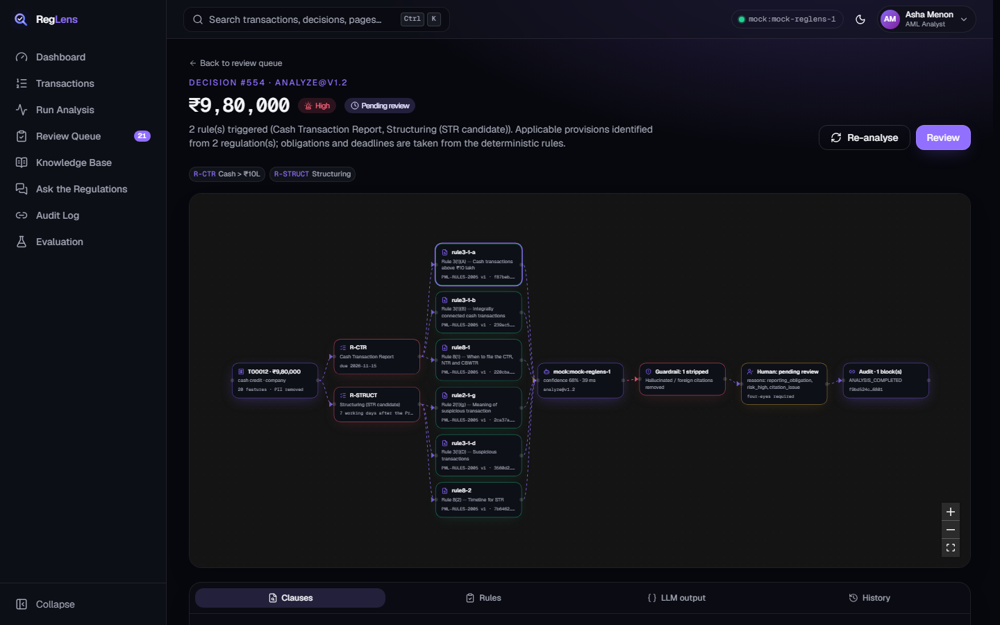 **Decision trace** — React Flow graph revealed step by step; clause panel with cited sentences highlighted, hash/version badges, stripped citations. | 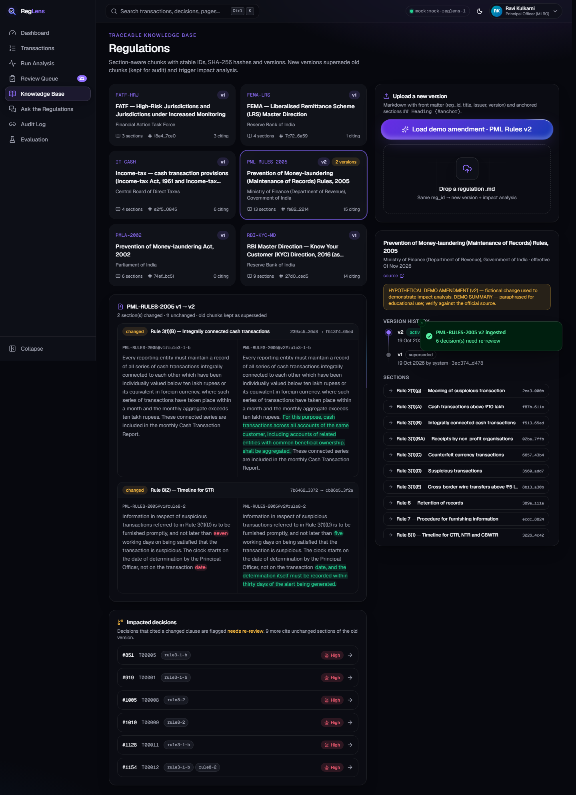 **Knowledge base** — version timeline, animated word-level diff, impacted decisions. |
| 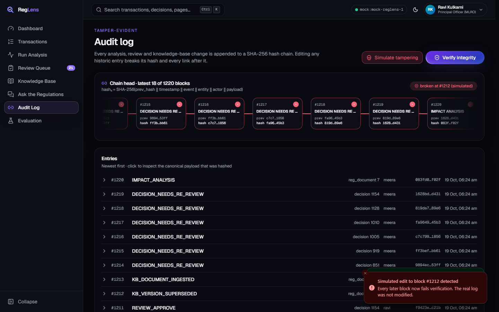 **Audit log** — chain of blocks, sequential integrity check, tamper simulation turning the chain red. | 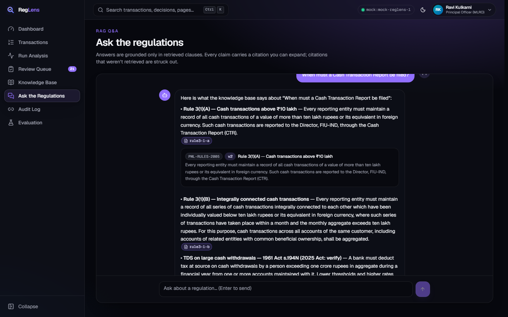 **Ask the regulations** — token streaming, typing indicator, expandable citation chips. |
| 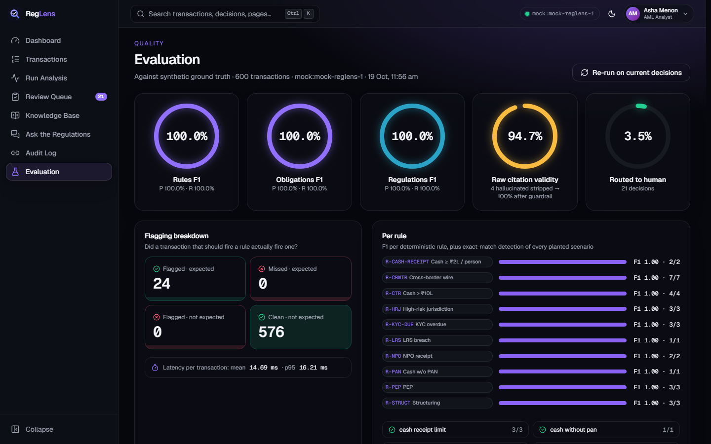 **Evaluation** — animated gauges, flagging breakdown, per-rule F1, scenario checklist. | 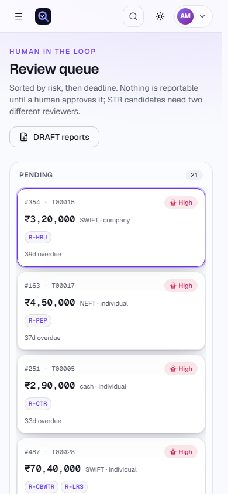 **Responsive + light mode** — every page QA'd at 390 px and 1440 px in both themes. |

Global: command palette (**Ctrl/⌘ K**), `G` + letter navigation, collapsible animated sidebar, reviewer switcher,
circular View-Transition theme switch, skeleton loaders, optimistic updates, toasts, illustrated empty states, 404.

### Animation inventory (all Motion, `prefers-reduced-motion` respected)
| Where | Animation |
|---|---|
| Landing | Aurora + spotlight + particle field, word-by-word blur-in headline, rotating word, scroll-linked hero card (parallax + 3D tilt), animated-beam pipeline with particles flowing along the connectors, marquee, in-view bento reveal |
| Shell | Route transitions (AnimatePresence), sliding active-nav indicator (`layoutId`), animated sidebar width, spring command palette, circular theme reveal |
| Dashboard | Staggered bento entrance, number tickers, chart draw-in, ripple risk pulse, risk-mix bar grow, self-drawing timeline |
| Run analysis | Progress ring, rolling counters, animated list (springs in, pushes rest down), border beam while running |
| Review queue | Cards animate between columns (`layout`), shared-element open (`layoutId`), hold-to-approve radial fill, approval avatars pop in, confetti + check morph |
| Trace | Nodes reveal step by step with bouncy springs and animated edges; highlighted sentences sweep in; tab indicator slides |
| Knowledge base | Diff columns slide in, changed words highlight-sweep, impacted decisions stagger in |
| Audit | Blocks rise in, sequential verification ticks green; tamper shakes the block and propagates red |
| Evaluation | Gauges spring to value, confusion cells fill, per-rule bars grow |

### Performance & quality
* All routes code-split; React Flow, Recharts and the app shell are lazy. Motion's layout features load
  asynchronously. **Landing route: 230.8 KB gzipped JS** (measured on the production build).
* Only `transform` / `opacity` / `filter` are animated.
* `npm run test`: 57 backend tests, ESLint (zero warnings) and strict TypeScript all pass.
* Playwright QA (`frontend/qa/`): screenshots of 11 pages × 2 themes × 2 widths, horizontal-overflow check,
  zero console errors, a full demo-flow test and an animation recording.

## Evaluation (mock provider, synthetic ground truth)
From `backend/reports/eval.md`:

| Target | Precision | Recall | F1 |
|---|---|---|---|
| Rules fired | 1.000 | 1.000 | 1.000 |
| Obligations | 1.000 | 1.000 | 1.000 |
| Applicable regulations | 1.000 | 1.000 | 1.000 |

All 14 planted scenarios (large cash, monthly aggregation, structuring below ₹50k and ₹10L, cross-border wires,
high-risk jurisdictions, PEPs, NPO receipts, cash without PAN, ₹2L cash receipts, LRS cumulative breach,
overdue KYC) are detected exactly; normal traffic produces zero false positives. The mock deliberately
hallucinates 4 citations — the guardrail strips all of them (raw validity 94.7 % → 100 %). 3.5 % of
transactions are routed to a human. Mean latency ≈ 15 ms per transaction in mock mode.

These numbers are high **by construction**: the ground truth is synthetic and the rules were written for
those scenarios. The interesting measurements with a real LLM (`LLM_PROVIDER=claude`) are regulation-level
precision/recall and raw citation validity.

## Limitations
* Regulatory texts are short paraphrased summaries, not the law; section numbers under the Income-tax Act, 2025 are not verified.
* Rule coverage is a demo subset (no counterfeit-currency detection, TDS 194N, SFT aggregation, sanctions screening, etc.).
* Single-node SQLite; the audit chain is serialised per process. A production system would use Postgres, WORM storage and real identity/authorisation (the reviewer switcher is a demo).
* Draft exports are CSV/Markdown, not FIU-IND FINnet XML.
* The 21st.dev registry currently requires a signed-in account, so components were rebuilt (see credits).

## Credits — 21st.dev components
The 21st.dev registry (`https://21st.dev/r/<author>/<component>`) returned **HTTP 403 "Authentication
required"** from this environment and the 21st.dev Magic MCP was not connected, so each component below was
**rebuilt** with Motion + Tailwind in the same style, adapted to the RegLens design tokens, strict TypeScript and
reduced motion. Source files carry an attribution header.

| Component | Author | Source | Used in | Status |
|---|---|---|---|---|
| Aurora Background | manuarora700 | https://21st.dev/@manuarora700/components/aurora-background | Landing hero | Rebuilt |
| Spotlight | manuarora700 | https://21st.dev/@manuarora700/components/spotlight | Landing hero | Rebuilt |
| Text Generate Effect | manuarora700 | https://21st.dev/@manuarora700/components/text-generate-effect | Landing headline | Rebuilt |
| Animated Tooltip | manuarora700 | https://21st.dev/@manuarora700/components/animated-tooltip | Reviewer avatars | Rebuilt |
| Timeline | manuarora700 | https://21st.dev/@manuarora700/components/timeline | Deadlines, KB versions, trace history | Rebuilt |
| File Upload | manuarora700 | https://21st.dev/@manuarora700/components/file-upload | CSV + regulation upload | Rebuilt |
| Number Ticker | dillionverma | https://21st.dev/@dillionverma/components/number-ticker | KPIs, evaluation | Rebuilt |
| Border Beam | dillionverma | https://21st.dev/@dillionverma/components/border-beam | Hero card, live run, STR cards | Rebuilt |
| Animated Beam | dillionverma | https://21st.dev/@dillionverma/components/animated-beam | Landing pipeline (+ particles) | Rebuilt, extended |
| Shimmer Button | dillionverma | https://21st.dev/@dillionverma/components/shimmer-button | Primary CTAs | Rebuilt |
| Marquee | dillionverma | https://21st.dev/@dillionverma/components/marquee | Regulations strip | Rebuilt |
| Magic Card | dillionverma | https://21st.dev/@dillionverma/components/magic-card | Bento cards, KB documents | Rebuilt |
| Animated List | dillionverma | https://21st.dev/@dillionverma/components/animated-list | Live analysis feed | Rebuilt |
| Bento Grid | dillionverma | https://21st.dev/@dillionverma/components/bento-grid | Landing features, dashboard | Rebuilt |
| Dot Pattern | dillionverma | https://21st.dev/@dillionverma/components/dot-pattern | Hero, 404 | Rebuilt |
| Ripple | dillionverma | https://21st.dev/@dillionverma/components/ripple | Dashboard risk pulse | Rebuilt |
| Animated Gradient Text | dillionverma | https://21st.dev/@dillionverma/components/animated-gradient-text | Hero badge | Rebuilt |
| Word Rotate | dillionverma | https://21st.dev/@dillionverma/components/word-rotate | Hero sub-headline | Rebuilt |
| Blur Fade | dillionverma | https://21st.dev/@dillionverma/components/blur-fade | Section reveals | Rebuilt |
| Animated Circular Progress Bar | dillionverma | https://21st.dev/@dillionverma/components/animated-circular-progress-bar | Analysis ring, evaluation gauges | Rebuilt |
| Particles | dillionverma | https://21st.dev/@dillionverma/components/particles | Landing hero | Rebuilt |

Theme toggle, hold-to-approve button, command palette and trace graph nodes are original to RegLens.
To use the originals instead, sign in to 21st.dev (or connect the Magic MCP) and run
`npx shadcn@latest add "https://21st.dev/r/<author>/<component>"` inside `frontend/`.
